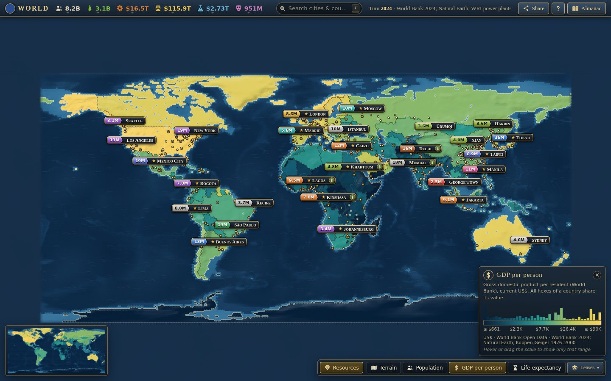
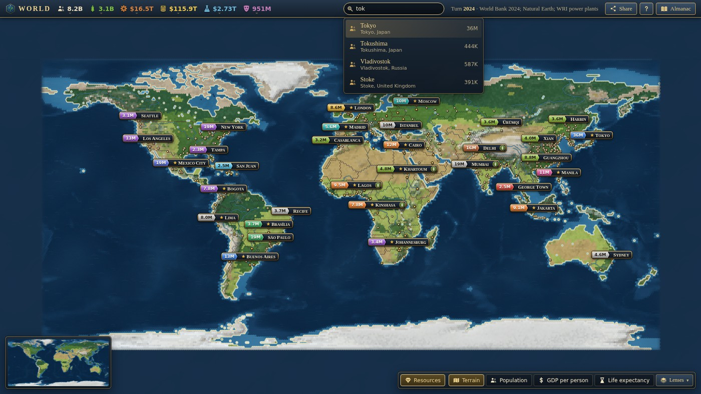

<picture>
  <source media="(prefers-color-scheme: dark)" srcset="docs/images/logo-dark.png">
  
</picture>

The whole world, drawn as a Civilization-style map 
Every border, every city, every number comes from public data
 

**English** · [中文](README.zh.md)
 

 

[Open the live map →](https://world-civilization-map.com)

[**chinaciv**](https://china-civilization-map.com) · China drawn as a Civilization-style map · [GitHub](https://github.com/Liuziyu77/chinaciv)

## A Civilization-style map of the world

18,792 hexagons of land cover every country on Earth. Each one carries its own elevation, climate zone and
terrain; 167 countries have a border band and a panel, 1,519 cities have a banner with real population and
yields, and 6,955 power plants sit on the hexes where they stand.

It takes what the world already is and redraws it in the language of a strategy game, so you can see at a
glance where people live, how income changes as you walk inland from a coast, and which continents are
mountains with a thin ribbon of city along the edge.

## How to use

**Switch layers.** 15 layers recolour the map: population and density, GDP and GDP per person, urban share,
life expectancy, electricity and internet access, climate zone, forest, cropland, terrain roughness, distance
to the sea.

**Open a country.** The country panel gives population, the five yields with world rank, society stats beside
the world average, the industry mix, and its biggest mapped cities.

**Open a city.** 1,519 city banners open a city screen with population, yields, society and industries.

**Search.** `/` jumps to any city or country; the address bar always holds the current view, so a link
reopens exactly what you were looking at.

## Examples

| | | |
|---|---|---|
|  |  |  |
| GDP per person | Climate zones | City screen · Tokyo |
|  |  |  |
| Country panel · Nigeria | Layer picker | Search |

## What's on the map

| | |
|---|---|
| **59,580** hexagons (70 km, 331 × 180), **18,792** of them land | **167** countries, each with a border band and a panel |
| **1,519** city banners, including all 178 national capitals | **6,955** power plants ≥ 100 MW, by fuel |
| **15** data layers | **220** rivers and the major lakes, from Natural Earth |
| Terrain from global elevation tiles, 13 samples per hex | Biomes from Köppen–Geiger climate zones |

Five yields: 🌾 Food (cereal production), ⚙️ Production (manufacturing value added), 💰 Gold (GDP), 🔬 Science
(R&D spending), 🎭 Culture (international tourist arrivals) — all country-level World Bank indicators.

## Build it together

The data behind this map still contains errors and gaps. Issues and pull requests are very welcome — come
build it with us.

### Contributors

Merged pull requests are added here.

## Credits

The visual language and engine come from [Andrej Karpathy](https://karpathy.ai/)'s
[usaciv](https://karpathy.ai/usaciv). The numbers come from the World Bank, Natural Earth, the World Resources
Institute, Köppen–Geiger and the AWS terrain tiles. Code is released under [Apache-2.0](LICENSE).

A visualization, not an official map. Borders follow Natural Earth 1:50m; disputed areas are drawn as that
dataset draws them, with no political claim.
