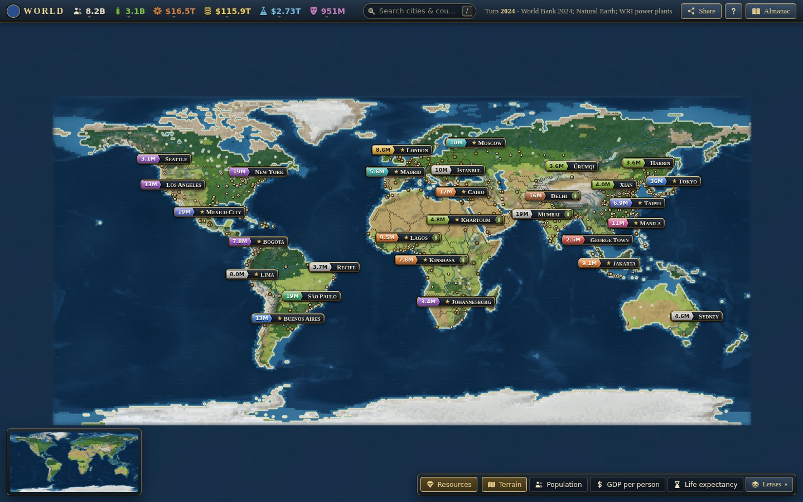
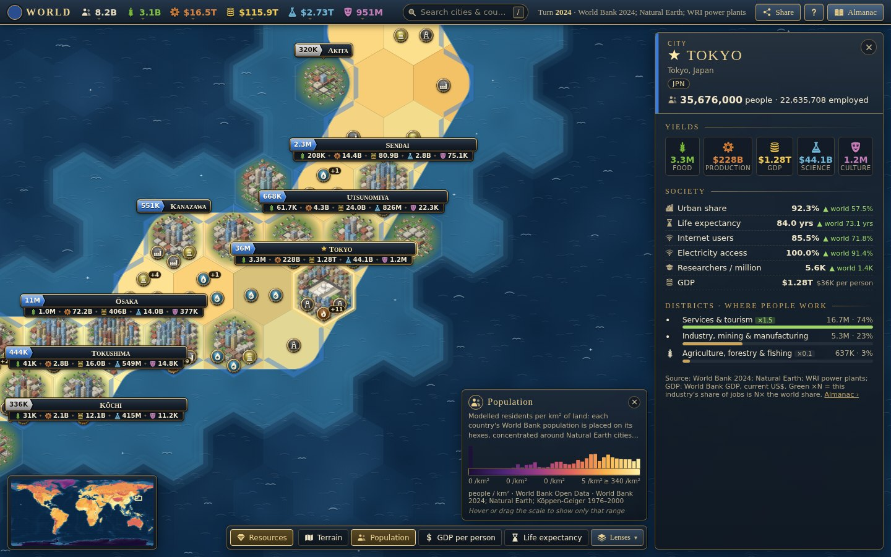
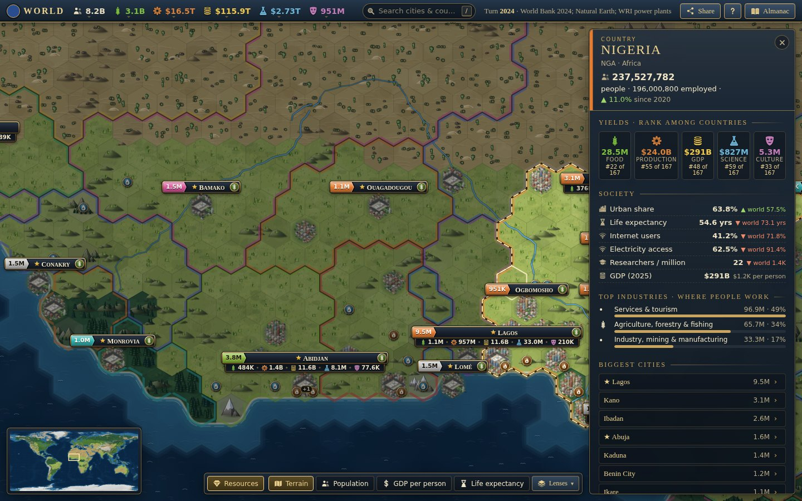

# worldciv: the world as a strategy-game map, drawn from real public data

<sub>Sister project · [**chinaciv**](https://github.com/Liuziyu77/chinaciv) — China drawn as a Civilization-style map · [china-civilization-map.com](https://china-civilization-map.com)</sub>



> **This is a visualization, not an official map.** Country outlines follow Natural Earth 1:50m; disputed
> areas are drawn as that dataset draws them, with no political claim. The hex grid generalises coastlines
> and borders, and the site is not for navigation or official use.

worldciv is a **visualization (not a game)**: the real world drawn as a turn-based 4X strategy map in the
visual language of *Civilization*. Terrain comes from real elevation and climate; every country has a border
band and a panel; every city has a banner whose population and five yields come from public statistics; and
6,955 power plants sit on the hexes where they stand. Every number can be traced to its source in the app's
**Almanac → Sources**.

The project is adapted from Andrej Karpathy's [usaciv](https://karpathy.ai/usaciv) (MIT): it keeps the
architecture and all of the hand-drawn code art, and replaces the data pipeline and interface with a world
version.

It is a static website: native ES modules + Canvas 2D, no framework, no npm, no build step. The data is
generated by a small Python pipeline from public downloads; no API keys are needed.

<table>
  <tr>
    <td></td>
    <td></td>
  </tr>
  <tr>
    <td></td>
    <td></td>
  </tr>
</table>

## What phase one includes

- **Map**: a 70 km hex grid (equirectangular projection in km, 331×180 cells, 59,580 hexes of which 18,792 are
  land). Terrain from global elevation tiles sampled 13 times per hex; biomes from Köppen–Geiger climate
  zones; 220 rivers and the major lakes from Natural Earth; ocean depth, coast and lake water types; hill
  shading from neighbouring hexes. Countries are coloured with border bands and named at mid zoom.
- **Territory**: 167 countries that own at least one hex, drawn from Natural Earth 1:50m admin-0. A hex is
  land when at least 7 of its 13 sample points fall inside a country polygon; the majority country owns it.
- **Cities**: 1,519 city banners — Natural Earth populated places of 300,000+ people plus every national
  capital (178 capitals). Their numbers are the country totals shared by the city's share of the national
  population, not a separate census.
- **Yields (top bar and banners)**:
  | Yield | Real measure (latest year) | Coverage |
  |---|---|---|
  | 💰 Gold | Gross domestic product, current US$ | 161/167 countries |
  | 🌾 Food | Cereal production, tonnes/year | 159/167 |
  | ⚙️ Production | Manufacturing value added, current US$ | 156/167 |
  | 🔬 Science | R&D spending (R&D % of GDP × GDP) | 134/167 |
  | 🎭 Culture | International tourist arrivals per year | 153/167 |

  All five are country-level World Bank indicators; the mapping rules live in `pipeline/build_stats.py` and
  are published in `nation.json` and the Almanac. A country with no value for an indicator shows "–", never 0.
  City yields use the same country total, split by population share.
- **Lenses**: 15 measures that recolour the map — population and density, GDP and GDP per person, urban share,
  life expectancy, internet and electricity access, elevation, climate zone, distance to the sea, forest,
  cropland, terrain roughness, city population.
- **Resources**: 6,955 power plants (≥100 MW) by fuel — hydro, nuclear, coal, gas, oil, wind, solar,
  geothermal and biomass — from the WRI Global Power Plant Database. Selection rules are written in
  `resources.json` and shown in the app.
- **Country panel**: population, employed, five yields with world rank, society stats (urban share, life
  expectancy, internet and electricity access, researchers) against the world average, top industries, and
  the biggest mapped cities.
- **City panel**: population, five yields, society stats and the industry mix, with a link to its country.
- **Reports**: click any top-bar yield for its definition, country and city leaderboards, and a related lens.
- **Almanac**: about this map, yields, countries, terrain, lenses, resources and every source with publisher,
  licence and vintage.
- **Share and navigation**: the address bar always holds the current view; `/` searches cities and countries;
  `?` shows shortcuts; works on phones.

## Quick start

The generated `web/data/` (about 7.3 MB) is committed, so the site runs as-is:

```bash
cd web && python3 -m http.server 8000     # http://localhost:8000
```

To regenerate the data from the original publishers (Python 3.12 + numpy + Pillow):

```bash
python3.12 pipeline/fetch_data.py         # ~90 MB of raw downloads, once
python3.12 pipeline/build_world.py        # ~5 s → world.json + cells.npz
python3.12 pipeline/build_stats.py        # ~5 s → web/data/*.json
```

### Commands

```bash
python3.12 pipeline/fetch_data.py         # Natural Earth, Köppen, World Bank, WRI, terrain tiles (cached)
python3.12 pipeline/build_world.py        # rasterise countries/lakes/climate, sample 13 points per hex
python3.12 pipeline/build_stats.py        # country panels, cities, population model, lenses, power plants
python3.12 pipeline/check_data.py         # validate web/data against docs/DATA.md (exit 1 on failure)
```

## How it works

```
pipeline/
  fetch_data.py     one file per source family → pipeline/cache/ (skips what is already there)
  build_world.py    0.05° rasters of countries, lakes, urban areas and climate; 13 samples per hex;
                    elevation/relief/water/biome → pipeline/out/world.json + cells.npz
  build_stats.py    World Bank series, city list, population model, coast distance, lenses, plants
  check_data.py     contract checks and a data-quality report over web/data
  lib/geo.py        GeoJSON helpers and polygon rasterisation (numpy + Pillow only)
web/                static site: js/ (map renderer, banners, panels, Almanac), data/ (generated JSON)
docs/DATA.md        the data contracts and the notes behind each table
```

The flow is always **source → build → web/data**. Amounts are current US$; distances are km; hex indices are
`row * cols + col`; the grid uses a `lon = -180 + x·360/width`, `lat = 85 − y/111.32` projection.

## Data sources

All public, none needs an API key. The Almanac → Sources page lists what was actually used.

| Data | Publisher / origin | Used for |
|---|---|---|
| Terrain Tiles (SRTM, GMTED, ETOPO1, GEBCO) | Mapzen, now AWS Open Data | Elevation, relief, hill shading, ocean depth |
| Köppen–Geiger climate classification (Beck et al.) | gloh2o.org | Biomes: rainforest, savanna, desert, scrub, temperate/boreal forest, tundra, ice |
| Natural Earth 1:50m admin-0 | Natural Earth (public domain) | Country outlines, borders |
| Natural Earth 1:10m populated places | Natural Earth (public domain) | Cities and capitals, coordinates, population |
| Natural Earth 1:50m lakes, rivers, urban areas | Natural Earth (public domain) | Lakes, rivers, built-up land cover |
| World Bank Open Data | World Bank (CC BY 4.0) | Population, GDP, manufacturing value added, cereal production, R&D, tourist arrivals, employment by sector, urban share, life expectancy, electricity/internet access, researchers, arable land |
| Global Power Plant Database | World Resources Institute (CC BY 4.0) | Power plants, fuel and capacity |

### How to read this map

- **Yields are real numbers with game names.** Gold is GDP; Food is cereal production; Production is
  manufacturing value added; Science is R&D spending; Culture is tourist arrivals. Nothing is invented.
- **Vintage is the latest available year** for each indicator (mostly 2024–2025). A missing value is shown as
  "–", never as 0; the country panel does not substitute another year silently.
- **Country values are uniform inside a country.** GDP per person, life expectancy, urban share and similar
  lenses are painted on every hex the country owns — the map is honest about this in the Almanac.
- **City yields are a share, not a census.** A city's five yields are its country's totals multiplied by the
  city's share of the national population.
- **Population is a model.** The density lens places each country's World Bank population on its hexes as
  Gaussian kernels around mapped cities plus a rural residual weighted by climate, elevation, relief and land
  cover. It is not a gridded census.
- **Positions are schematic.** Each hex is about 12,700 km² (140 km across); countries and islands smaller than
  a hex may not appear. A city sits at its coordinates, not at its metropolitan extent.
- **Antarctica** is drawn (ice and relief) but has no statistics.

### Boundaries and disclaimers

- This map is for personal study, **not an official or navigational map**; it has no cartographic approval
  number and must not be used as a published map.
- Country borders are Natural Earth 1:50m outlines. Disputed and unrecognised territories are shown as that
  dataset draws them; the project takes no political position.
- The hex grid generalises coastlines, borders and small islands; a border hex is assigned to the country
  under its centre or to the majority of its sample points.
- Data licences are listed below and in the Almanac; attribution is kept in `sources.json`.

### Credits and licence

Code is Apache-2.0 (see [LICENSE](LICENSE)) and is derived from Andrej Karpathy's usaciv (© 2026 Andrej
Karpathy, MIT); the MIT notice is reproduced in [NOTICE](NOTICE). The licence covers code only, not the data: each dataset follows its publisher's terms —
Natural Earth (public domain), World Bank (CC BY 4.0), WRI (CC BY 4.0), Köppen–Geiger (CC BY 4.0), Mapzen /
AWS terrain tiles (CC BY 4.0 and public-domain sources). Keep the attributions when reusing.

The look is inspired by turn-based 4X strategy games, but every icon, texture and shape is drawn by code; the
project is unaffiliated with any game publisher.

## Roadmap

- Wonders: UNESCO World Heritage sites as a map layer and a wonder list.
- Infrastructure: ports, airports and major roads/routes from Natural Earth and OpenStreetMap.
- Sub-national borders (admin-1) and a province-level panel where the World Bank has no data.
- A time slider for population and GDP (World Bank series 2000–2025).
- A finer grid around dense regions, and a proper population raster instead of the current model.
- Mobile: a country list and a search-first entry point.

---

# 中文

**worldciv（文明世界）：用真实数据画成策略游戏地图的世界**

<sub>姊妹项目 · [**chinaciv（文明中国）**](https://github.com/Liuziyu77/chinaciv) —— 把中国画成一张《文明》地图 · [china-civilization-map.com](https://china-civilization-map.com)</sub>


> **这是一张可视化作品，不是官方地图。** 国界依据 Natural Earth 1:50m 绘制，争议地区按该数据集的原样呈现，
> 不代表任何政治立场。六边形网格会概括海岸线与国界，本图不用于导航或正式用途。

worldciv 是一个**可视化作品（不是游戏）**：把真实的世界画成回合制 4X 策略游戏（《文明》风格）的六边形地图。
地形来自真实高程与气候；每个国家都有边界色带和面板；每座城市都有一面旗标，上面的人口与五种产出来自公开统计；
6,955 座电厂画在它们所在的地块上。每一个数字都能在应用内的**百科 → 数据来源**里追溯到出处。

本项目改编自 Andrej Karpathy 的 [usaciv](https://karpathy.ai/usaciv)（MIT 许可证），沿用其架构与全部手绘代码美术，
把数据管线和界面改成世界版。

它是一个静态网站：原生 ES 模块 + Canvas 2D，没有框架、没有 npm、没有构建步骤。数据由一个只用 Python 与
numpy/Pillow 的小管线从公开下载生成，不需要任何 API 密钥。

<table>
  <tr>
    <td></td>
    <td></td>
  </tr>
  <tr>
    <td></td>
    <td></td>
  </tr>
</table>

## 第一阶段包含什么

- **地图**：70 公里六边形网格（等距圆柱投影，331×180 格，共 59,580 格，其中 18,792 个陆地格）。地形取自全球高程瓦片，
  每格 13 个采样点；生物群系取自 Köppen–Geiger 气候带；220 条河流与主要湖泊来自 Natural Earth；区分海深、海岸与湖泊；
  相邻格高差做山体阴影。国家按颜色区分，中等缩放显示国名。
- **疆域**：167 个至少拥有一个格子的国家，取自 Natural Earth 1:50m admin-0。13 个采样点中至少 7 个落在国家多边形内
  即为陆地，多数票决定归属。
- **城市**：1,519 面城市旗标 —— Natural Earth 中 30 万人以上的居民点加全部首都（178 个）。城市数字是国家总量按
  城市人口份额分摊，不是独立普查。
- **产出（顶栏与旗标）**：
  | 产出 | 对应的真实指标（最新年份） | 覆盖 |
  |---|---|---|
  | 💰 金币 | 地区生产总值 GDP（现价美元） | 161/167 个国家 |
  | 🌾 粮食 | 谷物产量（吨/年） | 159/167 |
  | ⚙️ 生产力 | 制造业增加值（现价美元） | 156/167 |
  | 🔬 科研 | R&D 支出（R&D 占 GDP × GDP） | 134/167 |
  | 🎭 文化 | 入境游客人次/年 | 153/167 |

  五项都是国家级 World Bank 指标，映射规则写在 `pipeline/build_stats.py`，并发布在 `nation.json` 与百科中。
  某国没有该项数据时显示“–”，从不记为 0。城市产出用同一国家总量，按人口份额分摊。
- **透镜**：15 项可以给地图重新着色的指标——人口与密度、GDP 与人均 GDP、城市化率、预期寿命、互联网与电力覆盖、
  海拔、气候带、海岸距离、森林、耕地、地形起伏、城市人口。
- **资源**：6,955 座电厂（≥100 MW），按燃料分为水电、核电、煤电、气电、油电、风电、光伏、地热与生物质，
  来自 WRI 全球电厂数据库。入选规则写在 `resources.json` 中，并在应用里展示。
- **国家面板**：人口、就业、五项产出及世界排名、与世界均值对照的社会指标（城市化率、预期寿命、互联网与电力覆盖、
  每百万人研究人员数）、主要行业、以及该国最大的城市。
- **城市面板**：人口、五项产出、社会指标与行业构成，并可跳转到所属国家。
- **报告**：点击顶栏任一产出，查看定义、国家/城市排行榜与相关透镜。
- **百科（Almanac）**：关于本图、产出、国家、地形、透镜、资源，以及每个来源的发布者、许可与年份。
- **分享与导航**：地址栏始终保存当前视图；`/` 搜索城市和国家；`?` 查看快捷键；手机可用。

## 快速开始

`web/data/`（约 7.3 MB）已生成好，直接运行即可：

```bash
cd web && python3 -m http.server 8000     # http://localhost:8000
```

从原始发布者重新生成数据（需要 Python 3.12 + numpy + Pillow）：

```bash
python3.12 pipeline/fetch_data.py         # 约 90 MB 原始下载，只需一次
python3.12 pipeline/build_world.py        # 约 5 秒 → world.json + cells.npz
python3.12 pipeline/build_stats.py        # 约 5 秒 → web/data/*.json
```

### 命令

```bash
python3.12 pipeline/fetch_data.py         # Natural Earth、Köppen、World Bank、WRI、地形瓦片（有缓存）
python3.12 pipeline/build_world.py        # 栅格化国家/湖泊/气候，每格 13 个采样点
python3.12 pipeline/build_stats.py        # 国家面板、城市、人口模型、透镜、电厂
python3.12 pipeline/check_data.py         # 按 docs/DATA.md 校验 web/data（失败时退出码 1）
```

## 工作原理

```
pipeline/
  fetch_data.py     每类数据源一个下载入口 → pipeline/cache/（已存在则跳过）
  build_world.py    0.05° 的国家、湖泊、建成区、气候栅格；每格 13 个采样点；
                    高程/起伏/水体/生物群系 → pipeline/out/world.json + cells.npz
  build_stats.py    World Bank 序列、城市表、人口模型、海岸距离、透镜、电厂
  check_data.py     对 web/data 做契约校验与数据质量报告
  lib/geo.py        GeoJSON 工具与多边形栅格化（只依赖 numpy 与 Pillow）
web/                静态网站：js/（地图渲染、旗标、面板、百科）、data/（生成的 JSON）
docs/DATA.md        每个数据文件的格式与各表的构建说明
```

流程始终是 **数据源 → 构建 → web/data**。金额单位为现价美元；距离单位为 km；格子编号为 `row * cols + col`；
投影为 `lon = -180 + x·360/width`、`lat = 85 − y/111.32`。

## 数据来源

全部公开，均无需 API 密钥。百科的“数据来源”页列出了实际使用的每个文件。

| 数据 | 发布者 / 出处 | 用途 |
|---|---|---|
| Terrain Tiles（SRTM、GMTED、ETOPO1、GEBCO） | Mapzen，现为 AWS Open Data | 高程、起伏、山体阴影、海深 |
| Köppen–Geiger 气候分类（Beck et al.） | gloh2o.org | 生物群系：雨林、稀树草原、沙漠、灌丛、温带/寒带森林、苔原、冰盖 |
| Natural Earth 1:50m admin-0 | Natural Earth（公有领域） | 国家轮廓、国界 |
| Natural Earth 1:10m populated places | Natural Earth（公有领域） | 城市与首都、坐标、人口 |
| Natural Earth 1:50m 湖泊、河流、建成区 | Natural Earth（公有领域） | 湖泊、河流、城市地表覆盖 |
| World Bank Open Data | World Bank（CC BY 4.0） | 人口、GDP、制造业增加值、谷物产量、R&D、入境游客、三次产业就业、城市化率、预期寿命、电力/互联网覆盖、研究人员、耕地 |
| Global Power Plant Database | World Resources Institute（CC BY 4.0） | 电厂、燃料与装机容量 |

### 如何正确理解这张图

- **产出只是给真实数字起的游戏名字。** 金币就是 GDP；粮食是谷物产量；生产力是制造业增加值；科研是 R&D 支出；
  文化是入境游客。没有任何编造的数字。
- **年份取各指标最新可得的一年**（多为 2024–2025）。缺数据一律显示“–”，不记为 0，也不用其他年份悄悄替代。
- **国家级指标在同一国家内是均匀的。** 人均 GDP、预期寿命、城市化率等透镜会画在该国拥有的每一个格子上，
  百科里明确说明。
- **城市产出是份额，不是普查。** 城市的五项产出 = 国家总量 × 城市人口占全国人口的份额。
- **人口是模型。** 密度透镜把各国 World Bank 总人口按“城市高斯核 + 气候/海拔/起伏/地表覆盖加权的乡村余量”
  分配到本国格子，不是人口普查栅格。
- **位置是示意性的。** 每个六边形约 12,700 km²（对角 140 km）；比一个格子还小的国家和岛屿可能不出现。
  城市落在其坐标点上，不代表都市区范围。
- **南极洲**只画冰盖与地形，没有统计数字。

### 边界与免责声明

- 本图仅供个人学习，**不是官方地图，也不用于导航**；未申请审图号，不得作为正式出版地图使用。
- 国界依据 Natural Earth 1:50m 轮廓绘制，争议地区与未获普遍承认的政治实体按该数据集的原样呈现，
  本项目不持政治立场。
- 六边形网格会概括海岸线、国界与小岛；边界格按格心所在国家或采样点多数归属。
- 数据许可列在下方与百科中，署名信息保存在 `sources.json`。

### 致谢与许可

代码采用 Apache-2.0 许可证（见 [LICENSE](LICENSE)），改编自 Andrej Karpathy 的 usaciv（© 2026 Andrej Karpathy，MIT），MIT 声明收录于 [NOTICE](NOTICE)。
许可只覆盖代码，不覆盖数据：各数据集遵循其发布者的条款——Natural Earth（公有领域）、World Bank（CC BY 4.0）、
WRI（CC BY 4.0）、Köppen–Geiger（CC BY 4.0）、Mapzen / AWS 地形瓦片（CC BY 4.0 及公有领域来源）。
重新使用时请保留相应署名。

外观受回合制 4X 策略游戏启发，但所有图标、纹理和图形都由代码绘制；本项目与任何游戏发行商无关。

## 第二阶段设想

- 奇观：把 UNESCO 世界遗产做成地图图层与奇观列表。
- 地块改良：Natural Earth 与 OpenStreetMap 的港口、机场和主要公路/航线。
- 省级/一级行政区边界，以及 World Bank 无数据地区的省级面板。
- 时间滑块：2000–2025 年的人口与 GDP 序列。
- 人口密集区更细的网格，以及真正的人口栅格替代当前模型。
- 移动端：国家列表与搜索优先的入口。

欢迎分叉与实验。
