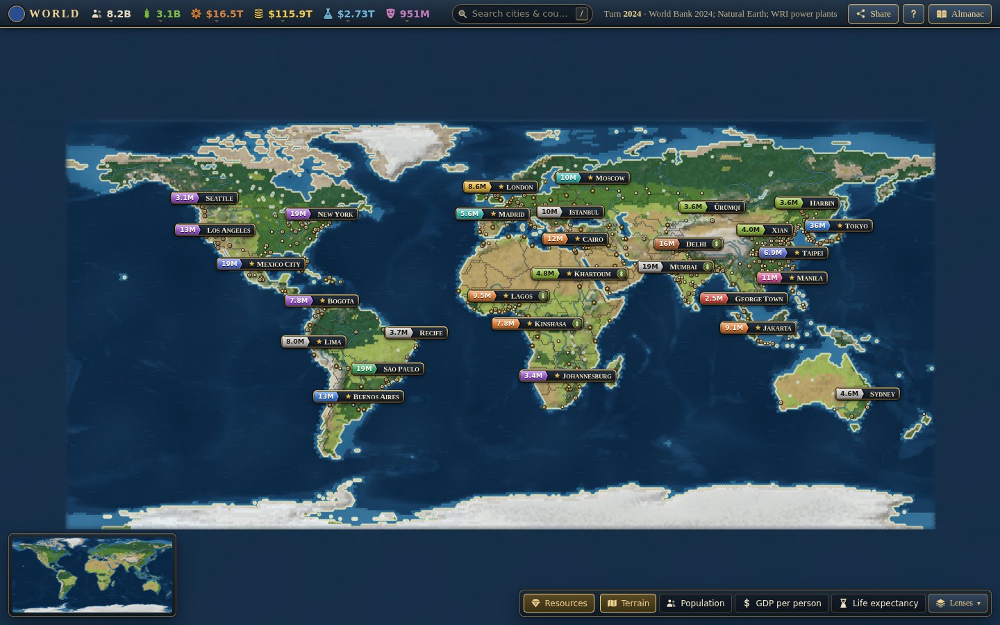
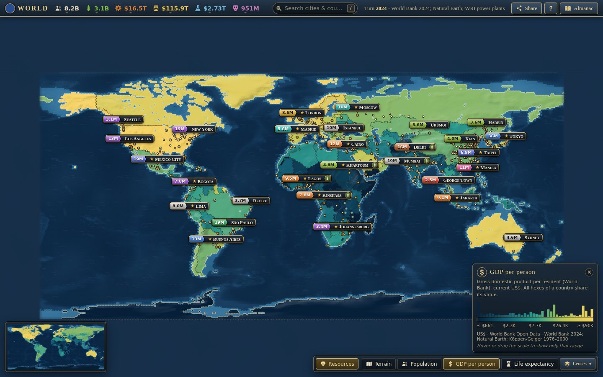
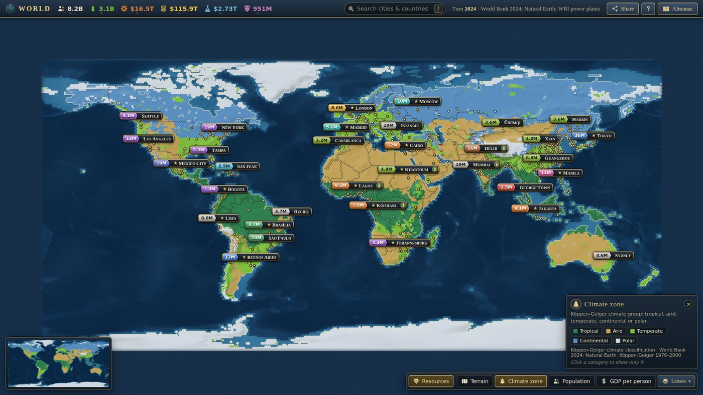
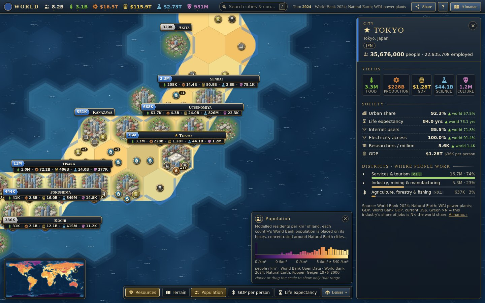
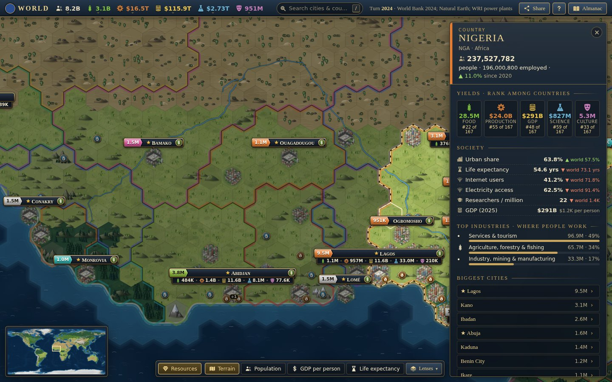
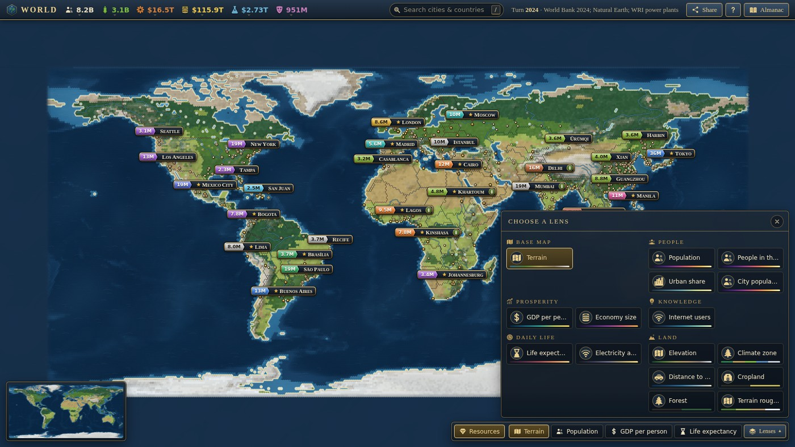
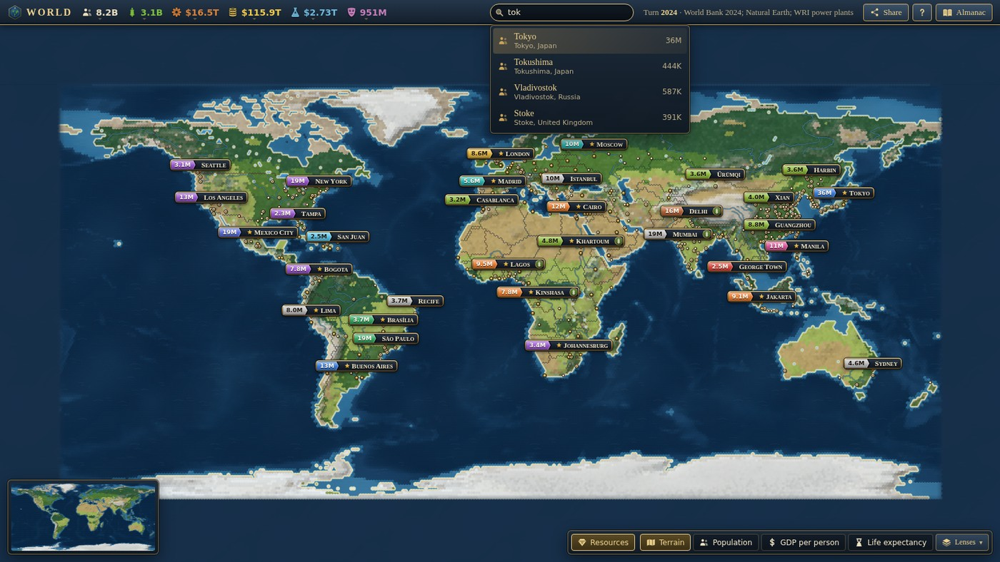

<picture>
  <source media="(prefers-color-scheme: dark)" srcset="docs/images/logo-dark.png">
  
</picture>

把整个世界，画成一张《文明》地图 
每一条边界、每一座城市、每一个数字，都来自公开数据
 

[English](README.md) · **中文**
 

 

[在线体验 →](https://world-civilization-map.com)

[**chinaciv**](https://china-civilization-map.com) · 把中国画成一张《文明》地图 · [GitHub](https://github.com/Liuziyu77/chinaciv)

## 《文明》世界地图

18,792 个陆地六边形盖住整个地球。每一格都有自己的海拔、气候带与地形；167 个国家各有边界色带和面板，
1,519 座城市插着写有真实人口与产出的旗标，6,955 座电厂画在它们真正所在的地块上。

它把世界已经发生的事，用策略游戏的语言重画了一遍——于是你能一眼看见人住在哪里，看见从海岸往内陆走
收入怎么变，看见哪些大陆其实是山，城市只是沿边的一条窄带。

## 使用说明

**切换图层。** 15 个图层覆盖人口与密度、GDP 与人均 GDP、城镇化率、预期寿命、电力与网络普及率、
气候带、森林、耕地、地形起伏、离海距离。

**国家详情。** 国家面板给出人口、五项产出与世界排名、与世界均值对照的社会指标、行业结构，以及国内
最大的几座城市。

**城市详情。** 1,519 面城市旗标点开是城市界面：人口、产出、社会指标与行业。

**搜索。** `/` 跳到任意城市或国家；地址栏始终保存着当前视图，链接总能重新打开你正在看的地方。

## 示例

| | | |
|---|---|---|
|  |  |  |
| 人均 GDP | 气候带 | 城市界面 · 东京 |
|  |  |  |
| 国家面板 · 尼日利亚 | 选择图层 | 搜索 |

## 地图上有什么

| | |
|---|---|
| **59,580** 个六边形（70 公里，331 × 180），其中 **18,792** 个是陆地 | **167** 个国家，各有边界色带与面板 |
| **1,519** 面城市旗标，含全部 178 个国家首都 | **6,955** 座 ≥100 MW 的电厂，按燃料分类 |
| **15** 个数据图层 | **220** 条河流与主要湖泊，来自 Natural Earth |
| 地形来自全球高程瓦片，每格采样 13 点 | 生物群系来自 Köppen–Geiger 气候分类 |

五种产出：🌾 粮食（谷物产量）、⚙️ 生产力（制造业增加值）、💰 金币（GDP）、🔬 科研（R&D 经费）、
🎭 文化（国际游客入境人次）——都是世界银行的国家级指标。

## 共建邀请

该地图在数据和准确性上依旧存在错误与误差，欢迎提交 [Issue](https://github.com/Liuziyu77/worldciv/issues)
和 [PR](https://github.com/Liuziyu77/worldciv/pulls)，与作者一同共建《文明》世界。

### 贡献者

PR 合并后会出现在这里。

## 致谢

地图视觉语言与引擎来自 [Andrej Karpathy](https://karpathy.ai/) 的 [usaciv](https://karpathy.ai/usaciv)；
数字来自世界银行、Natural Earth、世界资源研究所、Köppen–Geiger 与 AWS 地形瓦片。代码以
[Apache-2.0](LICENSE) 发布。

这是一张可视化作品，不是官方地图。国界依据 Natural Earth 1:50m 绘制，争议地区按该数据集原样呈现。
